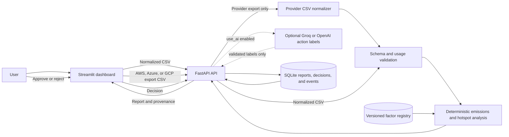
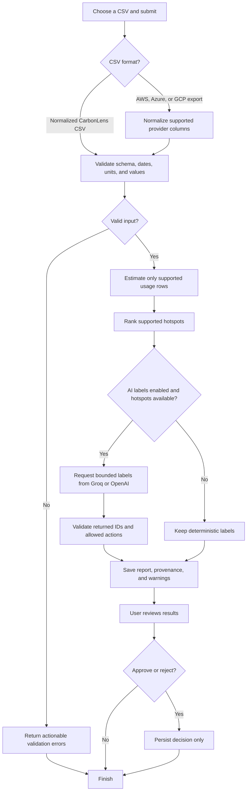

# CarbonLens 🌱

**Turn cloud usage data into explainable carbon insights and human-approved recommendations.**

CarbonLens is a single-user MVP for startup engineering teams. Users upload a normalized usage CSV or a supported AWS, Azure, or GCP billing-export CSV, review transparent rule-based emissions estimates, and receive AI-assisted explanations and recommendations they can approve or reject. The software is proprietary; see [LICENSE](LICENSE).

> **Status:** Runnable single-user MVP with methodology-v2 provider pass-through and ranged compute/storage screening estimates. The unchanged mixed sample has three covered rows using cited CCF assumptions and annual grid proxies; this is not full lifecycle coverage or measured impact. The original 2023 EPA facility-electricity reference remains available. See [methodology v2](#emissions-methodology-v2) for sources and limitations.

## Problem
Cloud bills show resource usage and cost, but do not always make it easy to identify emissions hotspots or prioritize practical sustainability actions. CarbonLens aims to connect emissions visibility with explainable, prioritized decisions.

## MVP goals
- Accept a documented normalized CSV or supported AWS, Azure, and GCP billing-export CSVs.
- Validate columns and flag missing or unsupported data.
- Calculate estimates using deterministic formulas and documented emission factors.
- Explain the top three supported hotspots with an LLM.
- Allow users to approve or reject recommendations; never change cloud resources automatically.
- Track the core product funnel with privacy-conscious analytics.
- Document assumptions, uncertainty, and limitations.

## Out of scope
- Direct cloud billing/API integrations.
- Automatic infrastructure changes.
- Carbon offsets or carbon-credit purchasing.
- Multi-team administration and enterprise access controls.
- Regulatory compliance certification or audited carbon accounting.

## Proposed user journey
1. User reviews the data and estimation limitations.
2. User uploads a normalized usage CSV or provider billing-export CSV.
3. CarbonLens validates the file and reports unsupported or missing fields.
4. The calculation layer estimates emissions only where inputs and methodology support it.
5. The results view presents the top three estimated hotspots, assumptions, and sources.
6. AI explains the results and suggests candidate actions.
7. The user approves or rejects each recommendation.
8. Product events measure workflow completion and onboarding friction.

## Stack
- Python 3.11+, FastAPI, Streamlit, pandas, Pydantic; CI covers Python 3.11 and 3.12
- Deterministic agent: validate, estimate, rank, explain, await human review
- Optional OpenAI or Groq action labeling; deterministic explanations remain authoritative
- SQLite for reports, human decisions, and privacy-minimized local funnel events
- pytest for automated tests, Ruff for lint/format checks, mypy for static type checking

## Architecture and Flow

The dashboard sends normalized CSVs directly to the API. Provider-export CSVs first pass through a provider-specific normalizer. The API validates rows, applies only compatible factors, builds deterministic hotspots, optionally requests bounded action labels from Groq or OpenAI, and stores the report and human decisions in SQLite. Cloud data is uploaded by the user; there is no scheduled sync or direct cloud-account connection.





## Repository structure

```text
carbonlens/
├── .github/workflows/ci.yml
├── .streamlit/config.toml
├── .gitattributes
├── .dockerignore
├── app.py
├── README.md  # all project documentation
├── LICENSE
├── pyproject.toml
├── requirements.txt
├── requirements-dev.txt
├── Dockerfile
├── compose.yaml
├── .env.example
├── .gitignore
├── data/
│   ├── sample_cloud_usage.csv
│   └── sample_aws_electricity_2023.csv
├── src/carbonlens/
│   ├── __init__.py
│   ├── config.py
│   ├── agent.py
│   ├── api.py
│   ├── storage.py
│   ├── data/
│   │   ├── __init__.py
│   │   ├── cloud_exports.py
│   │   ├── csv_loader.py
│   │   ├── export.py
│   │   └── validation.py
│   ├── emissions/
│   │   ├── __init__.py
│   │   ├── factors.py
│   │   ├── registry.json
│   │   ├── energy.py
│   │   └── calculator.py
│   ├── recommendations/
│   │   ├── __init__.py
│   │   ├── rules.py
│   │   └── llm_explainer.py
│   ├── analytics/events.py
│   └── models/schemas.py
└── tests/
    ├── conftest.py
    ├── test_agent.py
    ├── test_api.py
    ├── test_cloud_exports.py
    ├── test_csv_validation.py
    ├── test_emissions_calculator.py
    ├── test_estimation_v2.py
    ├── test_recommendations.py
    └── test_repository.py
```

## Getting started

### 1. Requirements
Python 3.11 is the minimum; Python 3.11 and 3.12 are exercised in CI. Run all commands from the repository root. This is a checkout-based application: the dashboard, sample data, and configuration live alongside the Python package.

### 2. Create a virtual environment

**Windows PowerShell**
```powershell
py -3.11 -m venv .venv
.venv\Scripts\Activate.ps1
```

**macOS / Linux**
```bash
python3.11 -m venv .venv
source .venv/bin/activate
```

### 3. Install dependencies
For running the application only:
```bash
python -m pip install -r requirements.txt
```

For development and all quality gates, use this instead:
```bash
python -m pip install -r requirements-dev.txt
```

Runtime dependencies are pinned in [requirements.txt](requirements.txt) and used by the package metadata. [requirements-dev.txt](requirements-dev.txt) installs the editable project with the pinned `dev` extra from [pyproject.toml](pyproject.toml): pytest, Hypothesis, Ruff, mypy, and pandas stubs matched to pandas 2.3. All direct runtime/dev dependencies and the build backend have exact version pins; transitive dependencies are not a full hashed lockfile.

### 4. Configure environment
```bash
cp .env.example .env
```
On Windows PowerShell: `Copy-Item .env.example .env`.

Never commit `.env`, API keys, real cloud bills, or confidential customer data.

### 5. Start the FastAPI backend
Run from the repository root:
```bash
python -m uvicorn carbonlens.api:app --app-dir src --host 127.0.0.1 --port 8001
```

### 6. Start the dashboard in another terminal
```bash
python -m streamlit run app.py --server.address 127.0.0.1 --server.port 8501
```

- Dashboard: http://127.0.0.1:8501
- Interactive API reference: http://127.0.0.1:8001/docs
- API health: http://127.0.0.1:8001/health

Choose **Mixed usage** and **Analyze sample** for three sourced operational screening scenarios with low/central/high values. Choose **AWS electricity (2023)** for the retained point-reference scenario: synthetic 240 facility kWh produces equal low/central/high values of 87.632145216 kg CO2e, explicitly indicating that uncertainty endpoints are unavailable, not zero uncertainty. Both sample types are labeled synthetic in saved reports. A matching header-only CSV template is available before analysis.

The dashboard shows estimation coverage, costs by currency, missing-factor reasons, source metadata, evidence-backed recommendations, effort, operational risks, next steps, approval/rejection, saved reports, and JSON/CSV downloads. Potential savings remain unknown without validated reduction scenarios. Approval never executes cloud changes.

The API is required; the dashboard does not silently bypass it. If changing the API port, update `CARBONLENS_API_URL` and `CARBONLENS_PUBLIC_API_URL` too.

## Runtime parameters

| Variable | Default | Purpose |
|---|---|---|
| `APP_ENV` | `development` | Set `production` to require an API key at startup |
| `CARBONLENS_API_KEY` | Empty | Shared single-user API key; sent in `X-API-Key` |
| `CARBONLENS_API_URL` | `http://127.0.0.1:8001` | Backend URL used by the dashboard server |
| `CARBONLENS_PUBLIC_API_URL` | API URL | Browser-accessible API documentation URL |
| `DATABASE_PATH` | `.local/carbonlens.db` | SQLite report, decision, and local event storage |
| `MAX_UPLOAD_MB` | `10` | API and dashboard upload limit, 1-100 MB; 50,000 rows maximum |
| `EMISSION_FACTORS_PATH` | Empty | Server-side reviewed factor JSON file |
| `LLM_PROVIDER` | Empty | Set `openai` or `groq` to enable optional labeling |
| `LLM_API_KEY` | Empty | Server-side provider credential; never entered in the dashboard |
| `LLM_MODEL` | Provider default | Optional override; defaults to `gpt-4o-mini` for OpenAI or `llama-3.3-70b-versatile` for Groq |

`.env` is loaded without overriding existing environment variables. Keep it private. LLM calls occur only when `use_ai=true` and there are supported recommendations. Only generated hotspot IDs, computed emissions, and fixed allowed-action labels are transmitted, not raw CSV data, service names, identifiers, or costs. Unavailable or invalid AI output falls back to deterministic explanations with a warning. Live provider calls require your credentials and were not needed for local tests.

## API contract

All `/api/v1` routes require `X-API-Key` when a key is configured. `/health`, `/docs`, and `/openapi.json` expose no stored reports and remain public.

| Method | Route | Parameters |
|---|---|---|
| `GET` | `/health` | Liveness |
| `GET` | `/api/v1/config` | Limits, providers, configured factor count, AI availability |
| `GET` | `/api/v1/factors` | Factor metadata and compatibility keys |
| `GET` | `/api/v1/registry` | Registry version, source dates, verified flags, accounting methods and usage coefficients |
| `POST` | `/api/v1/analyses` | Multipart `file` (.csv); query `top_n=1..3`, `use_ai=false` |
| `POST` | `/api/v1/analyses/exports` | Multipart `file` (.csv); query `provider=aws|azure|gcp`, `top_n=1..3`, `use_ai=false` |
| `POST` | `/api/v1/analyses/sample` | Same query parameters; `profile=mixed` (API default) or `profile=aws-electricity-2023` |
| `GET` | `/api/v1/analyses` | Query `limit=1..100`, default 20 |
| `GET` | `/api/v1/analyses/{report_id}` | UUID report identifier |
| `GET` | `/api/v1/analyses/{report_id}/csv` | CSV containing methods, bounds, range assumptions and structured provenance |
| `POST` | `/api/v1/analyses/{report_id}/decisions` | JSON `recommendation_id`, `decision`: `approved` or `rejected` |
| `POST` | `/api/v1/events` | JSON `name`: `onboarding_started` or `report_viewed`; the latter requires `report_id` |

Repeated identical decisions do not create duplicate decision events. Decisions can be revised; timestamps and local events record the change. Invalid data returns 422 with actionable errors, oversized uploads return 413, non-CSV uploads return 415, and unknown reports/recommendations return 404. OpenAPI documents the request and result schemas.

## Configure reviewed factors

The versioned [JSON registry](src/carbonlens/emissions/registry.json) contains the original EPA direct-energy reference, cited CCF compute/storage/PUE assumptions, narrowly mapped AWS/Azure grid proxies, and Google-published 2025 grid factors for Iowa, Mumbai and Delhi. Verification means a checked source transcription, not certification of actual reporting-year conditions. Historical proxy application and the CCF Azure PUE source conflict are disclosed, not hidden inside error bars. AWS/Azure India factors remain unconfigured. No CFE percentage is used to invent a market-based factor.

Set `EMISSION_FACTORS_PATH` to a schema-version-2 registry JSON, then restart the API. It replaces both factor and usage-profile registries. A legacy factor array is still readable, but unverified records are never used; `[]` disables modeled estimates without preventing provider pass-through. Dated factor versions must not overlap for the same key/accounting method. See [methodology v2](#emissions-methodology-v2) for exact metadata, units, source URLs/access dates, formulas, scenario definitions and exclusions.

For `data_basis=provider_reported`, the supplied `provider_kg_co2e` is retained unchanged with its `provider_methodology`, `provider_source_url`, and `provider_access_date`. Optional low/high provider values are retained; without them endpoints repeat central with an explicit no-uncertainty-data warning. Provider data is never recalculated or automatically reconciled with modeled activity, and its user-supplied attribution remains unverified.

Rows, recommendations, summaries and CSVs expose `method`, `low_kg_co2e`, `central_kg_co2e`, `high_kg_co2e`, and `range_assumption`. `estimated_kg_co2e` remains a compatibility alias for central. Incompatible methods/accounting bases/provider labels have separate `totals_by_method`; no combined number is claimed. Legacy stored point reports return 409 with a reanalysis request rather than invented ranges; their stored data is not changed.

## Container deployment

```bash
docker compose up --build -d
```

This starts both services on localhost with a persistent `reports` volume. `docker compose down` stops them without deleting reports. A factor file must be copied into the image before building or mounted read-only into the API container, and `EMISSION_FACTORS_PATH` must name its container path.

The default image target is `runtime` and does not install development tools. To reproduce the quality checks in a fresh Linux environment without starting services:

```bash
docker build --target checks --build-arg PYTHON_VERSION=3.11 -t carbonlens-checks:3.11 .
docker build --target checks --build-arg PYTHON_VERSION=3.12 -t carbonlens-checks:3.12 .
```

For an internet-facing deployment, use your hosting provider or a TLS reverse proxy with dashboard authentication, request-size limits, rate limits, and restricted API ingress. Set `APP_ENV=production` and a strong `CARBONLENS_API_KEY` in server secrets. Do not publish the unauthenticated Streamlit port directly: it holds the shared API credential server-side and grants access to the single-user workspace. This MVP does not isolate multiple tenants. Configure persistent storage, retention/backups, and access controls for stored usage data. Hosting accounts, a domain, and cloud deployment credentials are not included in this repository.

## Provider export uploads
In the dashboard, choose `AWS CUR`, `Azure Cost Management`, or `GCP Billing export` as the CSV format. The API accepts the same workflow at `POST /api/v1/analyses/exports` with a `provider` query parameter. AWS Cost and Usage Report/Data Export, Azure Cost Management export, and a flat CSV exported from a GCP Billing BigQuery table are supported by recognized column names. Files remain subject to the configured upload limit and 50,000-row cap.

This is immediate, user-triggered import, not a cloud connection or background sync. Freshness depends on when the provider export was generated. The original export file is not retained. Only fields needed for analysis are normalized into the saved report; resource and account identifiers are not imported.

Only recognized usage units are eligible for modeling. AWS instance-hours are converted to `vCPU-hour` only when the export includes `product_vcpu`; ambiguous units such as Azure VM `Hour` and binary GiB units are not guessed. Rows without usable quantities can remain as cost-only rows; spend is never converted into emissions. Unsupported usage is reported as not estimated.

## Input CSV contract
The normalized CarbonLens CSV remains available alongside native export uploads.

| Column | Meaning | Required |
|---|---|---|
| `provider` | `aws`, `azure`, or `gcp` | Yes |
| `service` | Cloud service/resource category | Yes |
| `region` | Cloud region identifier | Yes |
| `usage_quantity` | Numeric usage quantity | For `usage_only` rows |
| `usage_unit` | Unit for usage quantity | For `usage_only` rows |
| `period_start` | Usage period start | Yes |
| `period_end` | Usage period end | Yes |
| `cost_amount` | Cost amount if available | No |
| `currency` | Currency for cost | If cost provided |
| `energy_basis` | `facility`: energy including cooling overhead | For bundled electricity reference |
| `energy_source` | Nonempty reference to energy measurement/allocation evidence | For bundled electricity reference |
| `data_basis` | `usage_only` (default), `provider_reported`, or `cost_only` | No |
| `accounting_method` | `location_based` or `market_based`; unspecified remains unspecified for provider data | No |
| `storage_medium` | `hdd`, `ssd` or `unknown` | No |
| `provider_kg_co2e` | Provider figure in kg CO2e, never recalculated | Provider-reported rows |
| `provider_methodology` | Provider's methodology label, retained as supplied | Provider-reported rows |
| `provider_source_url` / `provider_access_date` | HTTP(S) evidence URL / ISO access date | Provider-reported rows |
| `provider_low_kg_co2e` / `provider_high_kg_co2e` | Optional provider-supplied bounds bracketing central; supply both or neither | No |

Provider-reported and cost-only rows need provider/service/region/reporting dates but do not require usage quantity/unit. Cost-only rows also require cost and currency; their emissions are not inferred from spend. These are CarbonLens normalized fields. Usage compute requires case-sensitive `vCPU-hour`; storage accepts decimal `GB-hour`, `TB-hour`, or one-complete-calendar-month `GB-month`. Bits, GiB, ambiguous instance-hours, GPUs, network, embodied emissions and unconfigured regions are not guessed.

Units must match the selected emission factor. Do not multiply arbitrary usage quantities by a generic factor. Unsupported services, missing regions, or incompatible units must be flagged rather than guessed.

## Emissions and AI safety principles
1. Calculations are deterministic and tested in Python, not generated by an LLM.
2. Each factor must include value, unit, source URL, version/date, geography, and applicable resource type.
3. All results are labelled estimates with assumptions and limitations.
4. Missing data or factors result in “not estimated,” with a reason.
5. AI summarizes computed results and suggests actions; it cannot invent numbers or execute changes.
6. Human approval records a decision only; it does not modify cloud infrastructure.
7. Uploaded files are untrusted data, not instructions to the LLM.
8. Do not send raw bills or unnecessary identifiers to analytics or an LLM provider.

## Product analytics
Local, privacy-minimized funnel events:
- `onboarding_started`
- `upload_submitted`
- `upload_validated`
- `report_viewed`
- `recommendation_approved`
- `recommendation_rejected`

**North Star metric:** Percentage of new users who obtain an approved top-three recommendation list within 10 minutes of starting the workflow.

Define the denominator, time window, and treatment of repeat users before reporting. Never fabricate results; report actual sample size and limitations.

Events contain only the event name, timestamp, and generated report ID, never raw CSV fields or secrets. Onboarding and report views are emitted by actual dashboard interactions, not inferred from report creation. Accepted analysis submissions and validation successes are recorded by the API, and human decisions by the persistence layer. Sample analyses are included in these exploratory logs; they are not real customer evidence. Session identity, repeat-user attribution, PostHog forwarding, and a production North Star metric are not implemented.

## Development checks
Install the development dependencies first. The same gates run in GitHub Actions on Python 3.11 and 3.12:

```bash
python -m pip check
python -m ruff check .
python -m ruff format --check .
python -m mypy
python -m pytest -q
```

Run only the Streamlit UI tests:

```bash
python -m pytest -q -m ui --strict-markers
```

These headless AppTest cases exercise both sample datasets, navigation, and approve/reject decisions against an in-process FastAPI client. No running servers, real bills, network calls, or provider credentials are needed. The complete pytest command includes UI tests. Additional tests cover CSV validation, deterministic calculations, source/date restrictions, unsupported factors, privacy, invalid AI responses, persistence, dependency separation, and repository hygiene.

GitHub Actions also runs the UI cases in an explicit step so they cannot be silently omitted from the matrix. The tracked-generated-file test runs when `.git` metadata exists; source archives without Git metadata skip only that check. Workflow/action and Streamlit testing references were checked against official documentation on 2026-10-27; see [contributing and release](#contributing-and-release).

Ruff's formatter enforces LF in Python; [.gitattributes](.gitattributes) applies LF to all maintained text in Git. Databases, caches, virtual environments, build output, and editable-install metadata are ignored and excluded from container build contexts. Runtime and quality commands can recreate local ignored artifacts; those files must never be committed. Stop services before deleting local databases and preserve any reports you need.

## Release preparation

The package and API version are `0.1.0`; the release remains unpublished until an authorized maintainer approves it, confirms green CI, finalizes the changelog entry, and creates the release tag. See [changelog](#changelog) and [contributing and release](#contributing-and-release).

## Secondary research
- [FinOps Foundation — State of FinOps](https://data.finops.org/)
- [Cloud Carbon Footprint — Methodology](https://www.cloudcarbonfootprint.org/docs/methodology/)
- [AWS Sustainability — Methodology](https://docs.aws.amazon.com/sustainability/latest/userguide/methodology.html)
- [Google Cloud Carbon Footprint — Methodology](https://docs.cloud.google.com/carbon-footprint/docs/methodology)

These sources inform discovery and methodology design; they do not validate demand for CarbonLens by themselves.

## Delivery target
**MVP target: 8 November 2026.**

Suggested milestones: secondary research → PRD and data contract → upload/validation/calculation → AI explanations and approvals → deployment, beta feedback, and portfolio case study.

## Disclaimer
CarbonLens is an experimental decision-support prototype. Outputs are estimates based on available data, selected methodology, and documented assumptions. It is not a substitute for provider-specific reporting, a verified greenhouse-gas inventory, professional advice, or regulatory compliance assessment.

## Product Requirements and Discovery

### Problem and target user

Startup engineering teams may struggle to turn cloud usage data into transparent emissions estimates and prioritized optimization decisions. The target persona is a startup engineering lead or cloud practitioner who owns infrastructure efficiency without a dedicated cloud-sustainability specialist.

> When I review cloud usage, I want to understand which supported workloads are estimated to contribute most to emissions and which actions are worth investigating first, so I can make informed decisions without manually stitching together multiple sources.

This is a user-need hypothesis informed by secondary research, not a validated finding from CarbonLens customer interviews. Discovery should ask:

- Which reports and tools does the target user already use?
- Which decisions are currently difficult or time-consuming?
- What data can users export safely and reliably?
- How do users evaluate recommendation trustworthiness?
- Must carbon visibility also include cost, effort, and reliability trade-offs?

### MVP requirements

The product objective is to test whether a transparent CSV-based cloud-emissions workflow with AI-assisted explanations and human-approved recommendations helps target users interpret results and choose an action.

In scope: normalized and supported provider-export CSV uploads; schema, type, unit, and period validation; estimates only where documented factors support them; visible provenance and limitations; a computed top-three list; optional LLM action labels; approve/reject feedback without executing changes; and privacy-conscious funnel events.

Out of scope: live provider API integrations or automatic cloud sync, automatic infrastructure modifications, offsets, enterprise administration, and compliance certification.

Acceptance criteria:

1. Invalid files produce actionable errors.
2. Unsupported service, region, or unit combinations are marked not estimated.
3. Every numeric estimate traces to a formula, factor, unit, and source.
4. AI cannot override computed numbers.
5. Recommendations are suggestions only.
6. Approvals do not trigger infrastructure changes.
7. Analytics do not include raw upload contents or secrets.

Key risks are provider CSV differences, incomplete factors, false precision, prompt injection, and limited user validation time.

### User stories

- **Upload data:** A startup engineering lead uploads supported cloud usage, sees schema validation, and receives row-level flags for missing or unsupported data rather than guessed conversions.
- **Understand emissions:** A user sees the factor/source for each estimate; insufficient inputs produce no numeric estimate; all outputs are labeled as estimates.
- **Review recommendations:** A user sees a short prioritized list grounded in computed results, rationale, and caveats. Approval or rejection records feedback only.
- **Improve workflow:** The product owner measures defined funnel steps without collecting raw CSV contents, secrets, or unnecessary identifiers.

### Research and positioning

Secondary research informs discovery and methodology but does not prove demand or adoption:

- FinOps Foundation, State of FinOps: https://data.finops.org/
- Cloud Carbon Footprint methodology: https://www.cloudcarbonfootprint.org/docs/methodology/
- AWS Sustainability methodology: https://docs.aws.amazon.com/sustainability/latest/userguide/methodology.html
- Google Cloud Carbon Footprint methodology: https://docs.cloud.google.com/carbon-footprint/docs/methodology

For future research entries, record title, publisher, URL, date, method/sample, exact finding, context, limitations, product implication, confidence, and access date. Working hypotheses are that users need actionable prioritization beyond a raw emissions figure; source transparency and uncertainty labels improve trust; and human-reviewed recommendations are more appropriate than automatic changes for this MVP. These remain unconfirmed hypotheses.

Competitor review should cover Cloud Carbon Footprint, AWS sustainability reporting, Google Cloud Carbon Footprint, and Azure sustainability capabilities. Compare provider/service coverage, input requirements, methodology, factor provenance, geographic/time granularity, uncertainty, cost optimization, recommendations, exports, pricing, and target users. CarbonLens's differentiation hypothesis is a small CSV workflow combining traceable estimates, AI-assisted explanation, a prioritized top-three list, and explicit human approval. Do not claim competitors lack these capabilities without verifying current documentation.

## Product Metrics

**North Star:** Percentage of new users who obtain an approved top-three recommendation list within 10 minutes of starting the workflow.

Funnel events, in order: `onboarding_started`, `upload_submitted`, `upload_validated`, `report_viewed`, then `recommendation_approved` or `recommendation_rejected`.

Supporting measures include upload validation success rate, time to report, approval/rejection rate, workflow completion, and qualitative usability issues. Before reporting, define the denominator, time window, repeat-user treatment, event definitions, sample size, dates, and missing-data handling. Do not claim statistical significance for small exploratory samples or fabricate results.

Guardrails: estimates retain provenance; unsupported inputs are not silently estimated; approval never changes cloud resources; analytics never collect raw bills. Current event records contain the event name, timestamp, and generated report ID. Sample analyses are included in exploratory logs but are not customer evidence. Session identity, repeat-user attribution, PostHog forwarding, and a production North Star metric are not implemented.

## Data and Samples

Only synthetic, public, or explicitly authorized data belongs in the repository. Never commit real cloud bills, credentials, customer identifiers, or employer-confidential data. Provider exports vary and may change; only recognized fields and units are used, and unsupported combinations remain unestimated. Cost is not a direct proxy for energy or emissions. Recommendations require engineering review, and synthetic data is not evidence of real-world impact.

- `data/sample_cloud_usage.csv` contains unchanged synthetic mixed-provider usage. Its three rows are covered by methodology-v2 operational screening scenarios using cited historical regional proxies; this is row coverage, not full lifecycle coverage.
- `data/sample_aws_electricity_2023.csv` contains synthetic AWS compute facility-electricity allocations in `us-east-1` during 2023. Synthetic 240 facility kWh produces a point-reference value of 87.632145216 kg CO2e using the primary EPA source; it is not customer activity or evidence of reductions.

The electricity reference requires `energy_basis=facility` and a nonempty `energy_source` evidence reference. Facility kWh includes cooling overhead. Do not relabel vCPU-hours or IT-only energy as facility kWh. Sample data is for development/testing only.

## Contributing and Release

CarbonLens is proprietary. Contributions require authorization from the copyright holders; this document does not grant redistribution rights. See [LICENSE](LICENSE).

Use Python 3.11 or 3.12 from the repository root in an activated virtual environment. Install `requirements-dev.txt` and run the [development checks](#development-checks). Apply mechanical formatting with `python -m ruff format .`; maintained text files use LF. Do not commit generated databases, caches, virtual environments, credentials, or real cloud bills. If ignored files were previously tracked, an authorized maintainer must remove them from the Git index; ignore rules alone do not untrack files.

Engineering guardrails:

- Audit existing behavior before editing and keep the normalized CSV backward compatible.
- Calculated values remain deterministic; AI cannot alter numbers or infrastructure.
- Keep provenance for numeric estimates, unsupported-input refusals, and human approvals.
- Do not invent factors, power coefficients, PUE, grid intensities, or provider schemas. Verify official sources and document URLs/access dates; leave unverified values unconfigured.
- Add regression tests and pass lint, formatting, type checking, and pytest before review.

GitHub Actions runs lint, formatting, mypy, backend/repository tests, and explicit Streamlit AppTest coverage on Python 3.11 and 3.12. UI tests need no browser, API keys, live bills, network calls, or running servers. Reference workflows include:

- https://docs.github.com/en/actions/use-cases-and-examples/building-and-testing/building-and-testing-python
- https://github.com/actions/checkout/tree/v6
- https://github.com/actions/setup-python/tree/v6
- https://docs.streamlit.io/develop/concepts/app-testing/get-started
- https://pypi.org/project/pandas-stubs/

Release checklist:

1. Review the complete diff and confirm no generated or confidential files are tracked.
2. Obtain green Python 3.11 and 3.12 GitHub CI runs on the intended release commit.
3. Confirm project/API version `0.1.0`, finalize the changelog date, and obtain release approval.
4. An authorized maintainer may create `git tag -a v0.1.0 -m "CarbonLens v0.1.0"`; pushing the tag is a separate authorized operation.

## Changelog

### 0.1.0 — Unreleased

**Phase 2 estimates:** Versioned JSON factor registry with source dates, accounting methods, and verification gates; provider-reported pass-through and cited compute/storage operational scenario ranges; method-separated totals and preserved CSV provenance; GCP India grid references and explicit exclusions; golden-value and Hypothesis tests for arithmetic, monotonicity, range ordering, and unit safety.

**MVP:** FastAPI analysis service and Streamlit dashboard; deterministic estimates with provenance and unsupported-input outcomes; historical EPA eGRID2023 electricity reference with strict inputs/date boundaries; human-reviewed recommendations, SQLite reports, private local events, and optional AI action labels.

**Phase 0 maintenance:** Pinned runtime dependencies and separate pinned development extra; Ruff and mypy checks with Python 3.11/3.12 CI, including Streamlit AppTest coverage; LF policy and generated-artifact exclusion checks; clean-container verification targets; proprietary licensing.

This is release preparation, not a published release. The v0.1.0 tag is not created until release approval and CI requirements are met.

## Assumptions and Limitations

- CSVs may not contain all inputs needed for emissions estimation; native provider exports differ and may change.
- Factors vary by geography, period, service, and methodology; estimates may differ from provider-reported values.
- Cost is not a direct proxy for energy use or emissions.
- Recommendations require engineering review; approval is feedback only and does not execute cloud changes.
- This MVP is not an audited inventory or compliance tool.

## Emissions Methodology V2

Registry version: `2026.10.27`. Source review date: **2026-10-27**. This is an experimental operational screening model, not an audited inventory, provider-report reproduction, full Cloud Carbon Footprint implementation, confidence interval, or verified savings calculation.

### Result contract

Every emission row returns `method`, `low_kg_co2e`, `central_kg_co2e`, `high_kg_co2e`, `range_assumption`, `accounting_method`, `provenance`, `assumptions`, and a reason if unsupported. `estimated_kg_co2e` remains a compatibility alias for central. No rounding changes stored provider figures. Source metadata and formulas travel with JSON and CSV; CSV embeds structured provenance as JSON text and escapes spreadsheet-formula prefixes.

- `provider_reported`: a supplied provider figure, never multiplied by energy coefficients, PUE, or grid factors. Provider attribution is user-supplied, not independently authenticated.
- `estimated_usage`: a deterministic modeled scenario or the retained direct-energy reference, with documented inputs and exclusions.
- `not_estimated`: all emission bounds and the compatibility value are null, with an explicit refusal reason. Unsupported usage is not zero emissions.

Provider-reported and modeled totals are separated. Location-based and market-based accounting are separated. Different provider methodology labels are separated. A single summary number is returned only for one compatible group; otherwise inspect `totals_by_method`. Group totals reference their input row IDs. These are sums of input scenarios, not a deduplicated inventory: even similarly labeled rows may overlap or have incompatible lifecycle scopes. No automatic provider-versus-model substitution is performed.

### Versioned registry

The packaged JSON registry is `src/carbonlens/emissions/registry.json`. It has `schema_version=2`, `registry_version`, `factors`, and `usage_profiles`. Factor records include source name/URL, access date, geography, version, application dates, method (`location_based` or `market_based`), `verified`, compatible provider/service/region/unit, value/unit, and notes. Profiles include power, storage, and PUE coefficients with the same source/date/geography/method/verification controls.

`verified=true` means the bundled numeric value was checked against its cited publication. It does not mean a workload was measured, that a source is scientifically exact, or that a historical factor is verified for 2026 conditions. Input metadata and provenance claims are not authenticated. Unverified records are never used. Missing or incompatible grid/profile records produce no estimate, not a global-average fallback.

Multiple dated factor versions may coexist, but their application windows cannot overlap for the same provider/service/region/unit/kind/accounting method. IDs must be unique. Invalid files are rejected before replacing active records. `EMISSION_FACTORS_PATH` replaces both factors and usage profiles with a configured registry; a legacy array remains readable but missing verification/access metadata leaves records unusable, and `[]` disables modeled estimates. Provider figures remain independent of registry configuration.

### Sources and transcriptions

All URLs below were accessed **2026-10-27**, except the retained primary EPA workbook whose original verified access date remains **2026-10-26**. EPA's current download page was rechecked on 2026-10-27. Provider CSV mappings are described in [provider export uploads](#provider-export-uploads); they are input adapters, not emissions factors, and do not imply full provider-schema coverage.

| Source | URL | Used for |
|---|---|---|
| Cloud Carbon Footprint, Compute/Storage/PUE sections and Appendices I/V | https://www.cloudcarbonfootprint.org/docs/methodology/ | Equations, generic power coefficients, HDD/SSD coefficients, published PUE assumptions, AWS/Azure geographic grid proxies |
| US EPA eGRID download page | https://www.epa.gov/egrid/download-data | Confirms eGRID2023 metric revision 2, dated 2025-06-12 |
| US EPA eGRID2023 metric revision 2 | https://www.epa.gov/system/files/documents/2025-06/egrid2023_data_metric_rev2.xlsx | Retained direct-energy reference: NRL23, SERC, NRC2ERTA, 365.1339384 kg/MWh |
| Google Cloud regional carbon data, 2025 data, page updated 2026-10-26 | https://cloud.google.com/sustainability/region-carbon | Iowa, Mumbai, and Delhi gross operational grid intensities; no CFE-percentage discount |
| Google Cloud Carbon Footprint methodology | https://docs.cloud.google.com/carbon-footprint/docs/methodology | Scope/accounting distinctions and why provider figures are passed through rather than reconstructed |

CCF is an open-source methodology publication, not primary per-workload telemetry. Its references to EPA, SPECpower, the US Data Center Energy Usage Report, Microsoft statements, and other work are not independently revalidated here. Google describes Electricity Maps as the source of regional grid data. Source-vintage and source-conflict limits remain visible in each record. Numeric coefficients are factual transcriptions; third-party source content retains its own terms (CCF Apache-2.0; Google documentation CC BY 4.0 unless otherwise noted).

### Usage coefficients

| Provider | Minimum W/vCPU | Maximum W/vCPU | Central utilization | PUE used |
|---|---:|---:|---:|---:|
| AWS | 0.74 | 3.5 | 0.5 | 1.135 |
| Azure | 0.78 | 3.76 | 0.5 | 1.185 |
| GCP | 0.71 | 4.26 | 0.5 | 1.1 |

All values are from CCF's cited public methodology. AWS/GCP values agree between the relevant sections and Appendix I. Azure's main PUE section states **1.185**, while Appendix I states **1.125**. V2 deliberately uses the explicit main PUE section value, records the unresolved conflict, and does not invent an uncertainty distribution from it. These are historical generic CCF fleet assumptions, not contemporary data-center measurements. Profile application windows run 2020-2026 as a versioned **model policy**, not a claim that hardware/PUE stayed constant or was measured for every year.

Storage uses CCF's **0.65 Wh/TB-hour for HDD** and **1.2 Wh/TB-hour for SSD**. Decimal units are explicit: 1000 GB = 1 TB, 1000 Wh = 1 kWh. These are unit definitions, not empirical coefficients. GiB, bits, and other dimensions are not silently converted. Storage quantities are assumed allocated capacity, not merely utilized bytes; this assumption must be reviewed.

### Grid records

| Application | Published value | Stored kg CO2e/kWh | Data vintage | Application window |
|---|---:|---:|---|---|
| Retained AWS compute us-east-1 direct facility kWh | EPA 365.1339384 kg/MWh | 0.3651339384 | 2023 | 2023 only |
| AWS us-east-1 usage model | CCF 0.000365127796 metric tons/kWh | 0.365127796 | CCF cites eGRID2023 | 2023-2026 |
| Azure eastus usage model | CCF East US 0.000379069 metric tons/kWh | 0.379069 | Not specified in CCF's Azure table | 2023-2026 |
| GCP us-central1 / Iowa | Google 432 gCO2eq/kWh | 0.432 | 2025 | 2025-2026 |
| GCP asia-south1 / Mumbai | Google 598 gCO2eq/kWh | 0.598 | 2025 | 2025-2026 |
| GCP asia-south2 / Delhi | Google 473 gCO2eq/kWh | 0.473 | 2025 | 2025-2026 |

CCF's AWS factor is a slightly different published derived figure from the retained primary EPA workbook value. V2 preserves each with its own ID/source rather than silently replacing either. Azure `eastus` is the normalized regional alias for CCF's East US / Virginia / SERC entry, not a native export schema.

Applying historical annual grid values to 2026 activity is an explicit **latest-published proxy scenario**. It is not verification of current-year grid intensity. The Azure source's unspecified underlying data vintage remains unspecified. Applications outside each record's window are refused; no future extrapolation is automatic. Geographic, temporal, grid, hardware, and PUE errors are **not bounded** by the scenario range. AWS and Azure India grid factors remain unconfigured/unverified in this release; GCP's India factors are not transferable across providers or arbitrary regions.

### Compute scenarios

Accepted normalized combination: `service=compute`, `usage_unit=vCPU-hour` (case-sensitive), with a configured provider profile and regional grid record. Quantities must already be normalized vCPU-hours, not instance-hours; vCPU counts are never guessed from provider names or costs.

```text
average_W = min_W + utilization * (max_W - min_W)
facility_kWh = vCPU_hours * average_W / 1000 * PUE
kg_CO2e = facility_kWh * grid_kg_per_kWh
```

Low/central/high use utilization **0 / 0.5 / 1** with fixed published coefficients, PUE, and grid factor. The endpoints are idle/full-load model scenarios; they are not confidence limits or guaranteed bounds on actual emissions. Unknown hardware, additional memory, hourly carbon variation, and changing grid conditions remain unquantified.

Golden example, AWS us-east-1, 1000 vCPU-hours:

```text
low     = 1000 * 0.74 / 1000 * 1.135 * 0.365127796 = 0.3066708358604 kg CO2e
central = 1000 * 2.12 / 1000 * 1.135 * 0.365127796 = 0.8785705027352 kg CO2e
high    = 1000 * 3.50 / 1000 * 1.135 * 0.365127796 = 1.45047016961 kg CO2e
```

### Storage scenarios

Accepted normalized combination: `service=storage` and `GB-hour`, `TB-hour`, or `GB-month`, case-sensitive. `GB-month` requires exactly one full calendar month with inclusive start/end dates; month length is calculated from those dates. Partial or multi-month periods must be supplied as GB-hours/TB-hours. No fixed 730-hour month is invented.

```text
TB_hours = GB_hours / 1000
TB_hours_for_one_calendar_GB_month = GB_months / 1000 * calendar_days * 24
facility_kWh = TB_hours * storage_Wh_per_TB_hour / 1000 * PUE
kg_CO2e = facility_kWh * grid_kg_per_kWh
```

With `storage_medium` absent/`unknown`, low uses HDD 0.65, high uses SSD 1.2, and central uses their arithmetic midpoint **0.925**. The midpoint is a CarbonLens scenario assumption, not a measured storage mix or separately published coefficient. With `hdd` or `ssd`, endpoints coincide and explicitly do not claim zero uncertainty. Replication is excluded; no number of replicas is guessed. Managed services whose underlying resources exceed the normalized storage allocation are outside the modeled boundary.

Golden Azure eastus example: 250 GB-month in October (744 hours):

```text
TB_hours = 250 / 1000 * 744 = 186
central = 186 * 0.925 / 1000 * 1.185 * 0.379069 = 0.07728430341825 kg CO2e
```

### Provider-reported figures

`data_basis=provider_reported` requires `provider_kg_co2e`, nonempty `provider_methodology`, HTTP(S) `provider_source_url`, and ISO `provider_access_date`. Provider rows need provider/service/region/reporting dates but not usage quantity/unit. These are CarbonLens normalized fields, not claims about AWS, Azure, or Google native CSV schemas. A caller must normalize an authorized provider report separately.

The central figure is retained unchanged. If both `provider_low_kg_co2e` and `provider_high_kg_co2e` are provided, they must bracket central and are retained unchanged too. Otherwise low/central/high repeat the provider figure and say the provider did not supply uncertainty bounds. This is not a fabricated statistical interval or a claim of zero uncertainty. Negative, nonfinite, unordered, incomplete, or unprovenanced figures fail validation; they never fall back to usage modeling.

`provider_methodology` is retained as a label. Optional `accounting_method` is `location_based` or `market_based`; omission remains unspecified for provider figures, never guessed. Provider figures can include scopes absent from the model. V2 does not reconcile them, discount them, infer procurement claims, or generate modeled optimization recommendations from them. User-provided attribution is marked unverified, independently of registry verification flags.

### Direct energy and exclusions

The original EPA entry remains unchanged for AWS compute us-east-1, facility `kWh`, reporting wholly in 2023, with `energy_basis=facility` and `energy_source`. Facility energy includes overhead: **PUE is not applied twice**. Direct-reference endpoints coincide because no uncertainty bounds are configured; this is labeled a point-reference scenario. Missing inputs or incompatible years still yield no estimate.

The usage model excludes GPU workloads, networking, additional memory, embodied equipment/building emissions, upstream fuel emissions, transmission losses, and storage replication. It does not derive energy from money, guess a region, estimate savings, or alter infrastructure. Approvals remain records only. AI only labels already-computed recommendations and cannot alter central values, endpoints, assumptions, or source records.

### Verification

Golden tests cover hand-derived compute/storage calculations, original EPA arithmetic, Google regional conversions, and provider pass-through. Hypothesis checks monotonicity, range ordering, unit equivalence, and incompatible-unit refusal. Regression tests cover missing/unverified factors, accounting/date mismatches, malformed provider figures, complete-month requirements, registry version windows, persisted reports, CSV provenance, and Streamlit approval controls.

The original unmodified mixed sample reaches 3/3 **row coverage** under these disclosed operational scenarios, not coverage of all cloud/lifecycle emissions. Legacy saved point reports stay stored but return a reanalysis-required response rather than being relabeled with invented ranges.

### Archived v1 source record

Methodology v1 is superseded by v2; its historical AWS electricity source is retained for auditability. The EPA eGRID2023 metric revision 2 workbook was released 2025-06-12 and accessed 2026-10-26. Its `NRL23` sheet, `NERC=SERC`, field `NRC2ERTA` is 365.1339384 kg CO2e/MWh, or 0.3651339384 kg CO2e/kWh. The workbook SHA-256 is `3dfbbcf2f949d58d5b2dbee3aab8150bd04a0c8ebb730ba1cd37a013bd4450ab`.

AWS `us-east-1` to the broader SERC NERC region is a CCF Appendix V geographic proxy, not proof of a workload's electricity supply. The reference requires facility kWh wholly in 2023, `energy_basis=facility`, and a nonempty `energy_source`; ordinary EC2 billing quantities are not facility kWh. The 240 kWh synthetic example yields 87.632145216 kg CO2e. The value is primary-source data; the activity is synthetic. No runtime spreadsheet parser is required.
